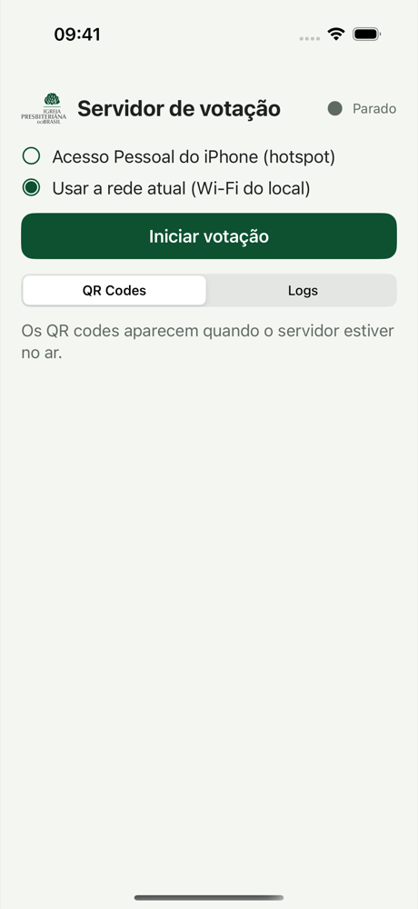
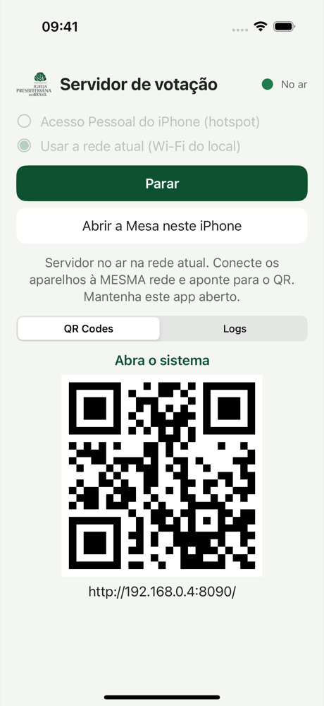
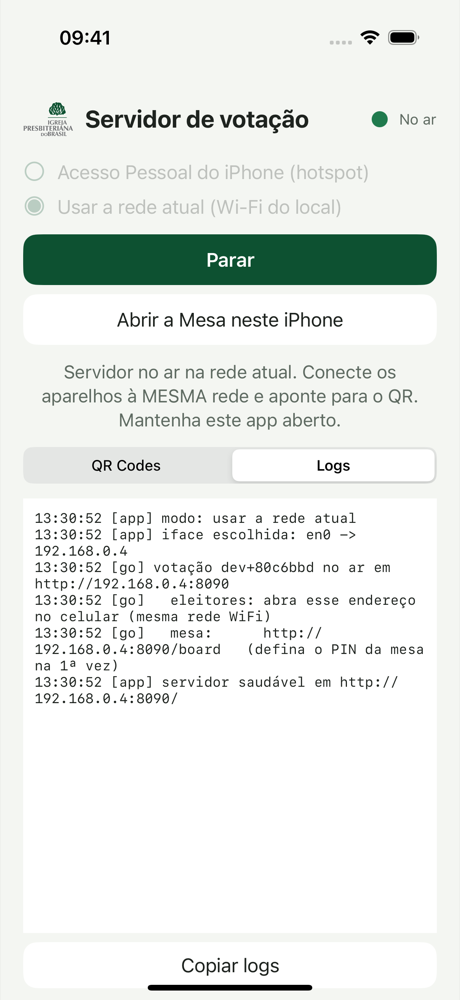
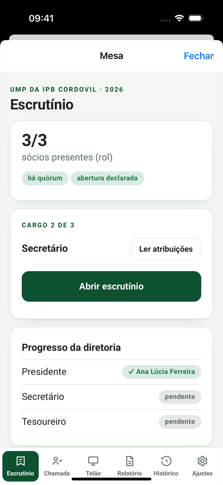

# App iOS: casca fina que hospeda o servidor

Este é o porte para iOS do [app Android](../android/README.md). É um app
SwiftUI mínimo que **embute o servidor Go** e cuida da rede: serve na rede do
iPhone (Acesso Pessoal ou Wi-Fi do local) e mostra os **QR codes** para os
aparelhos entrarem no Wi-Fi e abrirem o sistema. O motor da eleição é o
**mesmo binário único** de sempre: nenhuma regra de negócio vive no app.

Decisão de arquitetura: [ADR-0015](../docs/adr/0015-app-ios-casca-fina.md).

| | |
|---|---|
|  |  |
|  |  |

## Diferenças em relação ao Android (o que o iOS não deixa fazer)

| Android | iOS |
|---|---|
| Servidor como **processo filho** (`exec` de `libvotacao.so`) | O iOS proíbe `exec`. O servidor roda **no próprio processo** como biblioteca estática (`-buildmode=c-archive`), chamando o mesmo `internal/cli.Run` com os mesmos argumentos (`-addr :8090 -host <ip> -data <pasta>`) |
| **LocalOnlyHotspot**: o app cria a rede e lê o SSID e a senha | Não há API para criar hotspot. A Mesa liga o **Acesso Pessoal** em Ajustes, e o app serve na interface dele (`bridge100`, normalmente `172.20.10.1`). Nome e senha são digitados uma vez no app, só para gerar o QR do Wi-Fi |
| Foreground service + wake lock: o servidor vive com a tela apagada | O iOS **suspende** apps em segundo plano. A tela fica acesa enquanto o servidor estiver no ar, e o app precisa ficar **aberto, em primeiro plano**. Ao voltar do segundo plano, o app testa a porta e reinicia o servidor se o sistema tiver recolhido o socket |
| A Mesa abre no navegador | **"Abrir a Mesa neste iPhone"** abre a Mesa num navegador **dentro do app**. Trocar para o Safari suspenderia o servidor |

Modos de rede (seletor na tela; a escolha fica lembrada):

1. **Acesso Pessoal do iPhone (hotspot):** ligue em *Ajustes → Acesso
   Pessoal → Permitir Outras Conexões*. O nome da rede é o nome do iPhone
   (*Ajustes → Geral → Sobre → Nome*). Depende da operadora e do plano: em
   alguns planos o Acesso Pessoal não aparece.
2. **Usar a rede atual:** o iPhone já está no Wi-Fi do local. Vale o mesmo
   alerta de *AP isolation* do Android: **teste antes do evento**.

## Pré-requisitos

- macOS com Xcode 16+ (testado com 16.4) e Go (o do `go.mod`).
- [XcodeGen](https://github.com/yonaskolb/XcodeGen) (`brew install xcodegen`),
  só se for alterar o `project.yml`. O `.xcodeproj` gerado já vem versionado.
- Nenhuma dependência Swift de terceiros. O QR é gerado com CoreImage.

## Build e execução

```bash
./ios/build-go.sh            # 1. servidor Go → ios/VotacaoGo.xcframework (refaça a cada mudança no Go)
open ios/VotacaoHost.xcodeproj  # 2. ⌘R no simulador ou no aparelho
```

O scheme também roda o `build-go.sh` sozinho (pre-action) quando o
xcframework não existe. Pela linha de comando:

```bash
cd ios
xcodebuild -project VotacaoHost.xcodeproj -scheme VotacaoHost \
  -destination 'platform=iOS Simulator,name=iPhone 16 Pro' build
xcodebuild -project VotacaoHost.xcodeproj -scheme VotacaoHost \
  -destination 'platform=iOS Simulator,name=iPhone 16 Pro' test
```

> Se o `xcodebuild` reclamar de *"CoreSimulator is out of date"* (Xcode mais
> novo que o CoreSimulator instalado), use outro Xcode instalado com
> `DEVELOPER_DIR=/Applications/Xcode-16.4.0.app/Contents/Developer`, ou abra o
> Xcode novo uma vez para ele instalar os componentes.

**Aparelho físico:** selecione seu time em *Signing & Capabilities* (assinatura
automática). O bundle id é `app.votacao.host`, o mesmo do Android. Para
publicar no TestFlight ou na App Store é preciso uma conta Apple Developer; isso
fica fora deste escopo.

## Configurar a URL do servidor

Não há URL a configurar: o servidor **é o próprio app**. A URL que os
aparelhos abrem é montada pelo app com o IP da interface escolhida e a porta
fixa **8090** (`http://<ip>:8090/`), e vai no QR 2. No simulador, o modo
*Usar a rede atual* serve no IP de rede do Mac. Do próprio Mac,
`http://127.0.0.1:8090/` também funciona, porque o simulador compartilha a
rede do host.

A pasta de dados (um `.db` por eleição, ADR-0012) fica em
*Application Support/eleicoes* do app. Desinstalar o app apaga as eleições.

## Testes

- **XCTest (`VotacaoHostTests`):**
  - `RedeTests`: escolha da interface por modo, filtro de IPv4 privado e URL.
  - `QRTests`: payload `WIFI:` com escapes (mesma regra do Android) e geração da imagem.
  - `ServidorHostTests`: a máquina de estados (parado, iniciando, no ar, erro), com um motor dublê. Cobre os argumentos repassados ao binário, o Acesso Pessoal desligado, o erro do servidor, a queda inesperada, o QR do Wi-Fi e o reinício ao voltar do segundo plano.
  - `MotorGoTests`: integração com o **servidor Go de verdade** dentro do app. Sobe, responde HTTP, para e sobe de novo.
- **XCUITest (`VotacaoHostUITests`):** na tela, escolhe a rede, inicia, vê o
  QR e para. Com `TEST_RUNNER_VOTACAO_TOUR_DIR=<pasta>`, vira o roteiro dos
  screenshots e espera `<pasta>/fluxo-ok` antes de abrir a Mesa embutida (o
  fluxo de votação roda de fora, pela rede, como os celulares dos votantes).
- **Go (`internal/cli`):** `Run` encerra limpo ao fechar `stop`, pode subir
  de novo na mesma porta e devolve erro, em vez de `log.Fatal`, quando a porta
  está ocupada.

## Solução de problemas

| Sintoma | Causa provável |
|---|---|
| "Acesso Pessoal desligado" | Acesso Pessoal não ligado, ou "Permitir Outras Conexões" desmarcado |
| "Sem rede: conecte o iPhone a um Wi-Fi…" | Modo "rede atual" sem Wi-Fi nem Acesso Pessoal |
| Votantes perdem a conexão | O app foi para segundo plano, ou a tela bloqueou. Volte ao app: ele reinicia o servidor se precisar. Use o *Acesso Guiado* para travar o iPhone no app |
| "No such module 'VotacaoGo'" | Faltou rodar `./ios/build-go.sh` |
| Cliente na mesma rede não abre a URL | AP isolation no roteador: use o Acesso Pessoal |
| iOS pergunta sobre "Rede Local" | É esperado. Permita, senão os outros aparelhos não alcançam o servidor |

## Limites conhecidos

- **Só primeiro plano.** O servidor não sobrevive à suspensão do iOS. Para
  congressos longos, o notebook ou o Android continuam sendo o plano A, e o
  iPhone é bom para plenárias locais curtas e para contingência.
- **Clientes do Acesso Pessoal:** a Apple não documenta o limite (relatos
  falam em ~5 a 10 aparelhos). Ainda **não foi medido**.
- Testado no simulador (iOS 18.6). Falta o teste físico em aparelho com
  Acesso Pessoal, no mesmo roteiro do Android.
